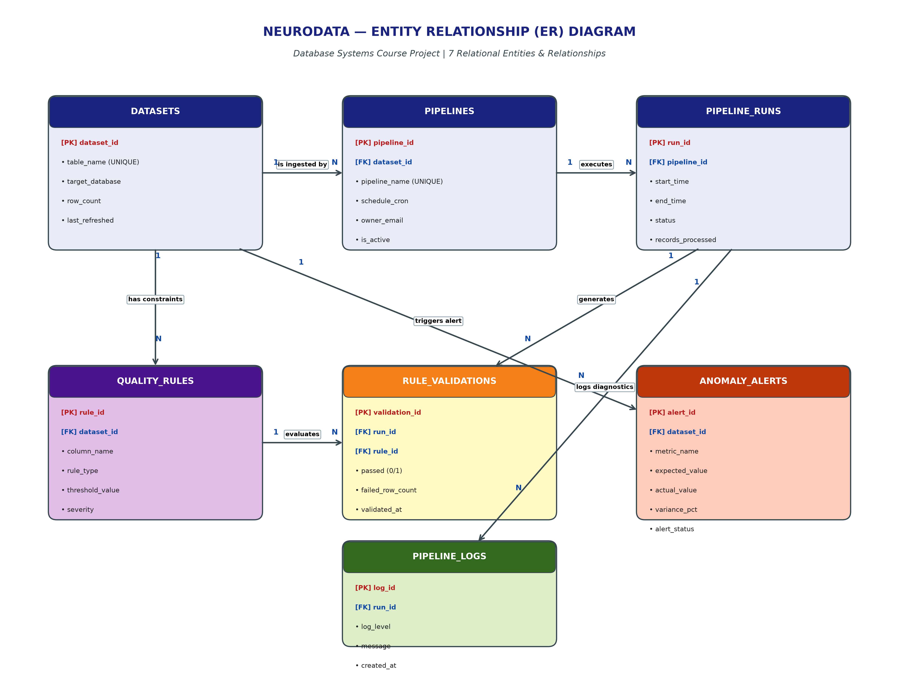

# 🧠 NeuroData — AI-Powered Data Quality & Pipeline Orchestration Platform

[](https://www.python.org/)
[](https://streamlit.io/)
[](https://www.mysql.com/)
[](LICENSE)

An enterprise-grade database management and automated data quality monitoring platform modeled after **Apache Airflow**, **Great Expectations**, and **Monte Carlo Data**. 

NeuroData tracks ETL data pipeline execution, enforces statistical data assertion constraints, auto-detects volume anomalies ($>30\%$ drop) using database triggers, calculates real-time SLA metrics, and provides an interactive web dashboard for monitoring and SQL query execution.

---

## 👥 Team Members

* **24BYB0105** — SYED AMANGANI  
* **24BDE0007** — JASWANTH REDDY  
* **24BYB0144** — SHANMUKHA SRIKAR  

**Course:** Database Management Systems Laboratory  
**Domain:** Data Engineering & AI Operations (MLOps / DataOps)

---

## 📌 Problem Statement & Solution

In enterprise data warehouses, automated ETL pipelines often encounter silent data corruption:
* **Missing values / Null Spikes:** Downstream machine learning models ingest unvalidated data, leading to severe prediction failures.
* **Sudden Data Volume Drops:** Upstream API outages result in massive row drops without throwing overt runtime exceptions.
* **Untracked Pipeline Health:** Lack of real-time SLA tracking and automated audit logging.

**NeuroData** addresses these issues with a database-centric architecture that embeds data assertion logic, procedural execution lifecycles, and event-driven triggers directly inside the RDBMS layer.

---

## 📊 Entity-Relationship (ER) Diagram

The system is normalized to **Third Normal Form (3NF)** across 7 relational entities:



### 🗄️ Relational Schema (7 Tables)

1. **`DATASETS`**: Stores data warehouse table metadata, target database, and monitored row counts.
2. **`PIPELINES`**: Stores ETL pipeline job configurations, cron schedules, ownership details, and active status.
3. **`PIPELINE_RUNS`**: Tracks individual execution instances, record volumes, timestamps, and status (`Running`, `Success`, `Failed`).
4. **`QUALITY_RULES`**: Defines assertion rules (`NOT_NULL`, `RANGE`, `UNIQUE`, `REGEX`, `ROW_COUNT_STABILITY`) with severity levels (`CRITICAL`, `HIGH`, `MEDIUM`, `LOW`).
5. **`RULE_VALIDATIONS`**: Records pass/fail evaluations and invalid row counts for each rule during a run.
6. **`ANOMALY_ALERTS`**: Logs automated anomaly alerts triggered by volume drops or degraded health scores.
7. **`PIPELINE_LOGS`**: Diagnostic logging trail (`INFO`, `WARN`, `ERROR`, `CRITICAL`) for audit and debugging.

---

## ⚙️ PL/SQL Implementation

| Component | Identifier | Purpose & Execution Flow |
| :--- | :--- | :--- |
| **Procedure 1** | `sp_execute_pipeline_run` | Initiates a pipeline run with `'Running'` status and logs an `INFO` start diagnostic. |
| **Procedure 2** | `sp_complete_pipeline_run` | Evaluates critical rule failures and transitions status to `'Success'` or `'Failed'`. |
| **Function 1** | `fn_calculate_pipeline_sla` | Returns the percentage SLA reliability uptime of a given pipeline. |
| **Function 2** | `fn_get_dataset_health_score` | Computes a normalized 0–100 Data Quality Health Score for a dataset. |
| **Cursor** | `cur_daily_quality_audit_sweep` | Sequentially audits all datasets and flags alerts if health score drops below $75\%$. |
| **Trigger 1** | `trg_detect_volume_anomaly` | `AFTER UPDATE ON DATASETS`: Automatically logs an alert if row count drops by $>30\%$. |
| **Trigger 2** | `trg_auto_log_failed_rule` | `AFTER INSERT ON RULE_VALIDATIONS`: Automatically writes `WARN` diagnostic logs on failed assertions. |

---

## 🔍 15 Relational SQL Queries

The repository includes 15 course-required SQL queries (`queries.sql`) covering:
* **Filtering & Sorting:** Active pipeline retrieval sorted alphabetically.
* **2-Table & 3-Table Joins:** Combining pipelines, datasets, and run histories.
* **Aggregations & Grouping:** Total runs and average throughput by status.
* **Subqueries:** Identifying datasets exceeding average row counts and subqueries with `IN`.
* **Common Table Expressions (CTE):** Advanced pipeline success/failure rate calculations.
* **Ranking & Limits:** Top 3 quality rules causing highest record failures.
* **Anomaly Variance Analysis:** Sorting divergence percentages between expected and actual values.

---

## 🖥️ Interactive Web Dashboard

Built with **Streamlit**, the web UI allows real-time interactive database operations:
* 📊 **Pipeline Dashboard:** Live KPI metric cards, SLA success rates, and dataset health scores.
* ⚡ **Pipeline Execution Simulator:** Execute `sp_execute_pipeline_run` and inspect dynamic diagnostic logs.
* 🛡️ **Quality Rules & Audit Logs:** Live view of active constraints and diagnostic execution traces.
* 🚨 **Anomaly Alert Center:** Trigger simulation testing `trg_detect_volume_anomaly` and cursor sweeps.
* 🔍 **15-Query SQL Runner:** One-click execution of all 15 SQL queries with tabular data display.

---

## 🚀 Quick Start & Installation

### 1. Clone the Repository
```bash
git clone https://github.com/YOUR_USERNAME/neurodata.git
cd neurodata
```

### 2. Install Dependencies
```bash
pip install -r requirements.txt
```

### 3. Launch the Application
```bash
python -m streamlit run app.py
```
Open your browser at `http://localhost:8501`.

---

## 📁 Repository Structure

```text
neurodata/
├── app.py                                # Streamlit Web Dashboard application
├── database.py                           # SQLite/MySQL backend engine & simulation layer
├── schema.sql                            # ANSI/MySQL DDL Table Creation scripts (7 Tables)
├── seed_data.sql                         # Seed data with 10+ records per table (70+ rows)
├── procedures_triggers.sql               # PL/SQL Procedures, Functions, Cursor & Triggers
├── queries.sql                           # 15 course-required SQL queries
├── requirements.txt                      # Project dependencies
├── er_diagram.png                        # High-resolution ER Diagram
├── staruml_er_diagram.png                # StarUML notation ER Diagram
├── neurodata_staruml.mdj                 # StarUML Project source file
├── NeuroData_Review_1_Report_20_17.pdf   # Review 1 submission report PDF
├── NeuroData_Review_2_Report.pdf         # Review 2 submission report PDF
├── generate_er_diagram.py                # Script to regenerate ER diagram
└── README.md                             # Comprehensive project documentation
```

---

## 📜 License
This project is licensed under the MIT License - see the [LICENSE](LICENSE) file for details.
